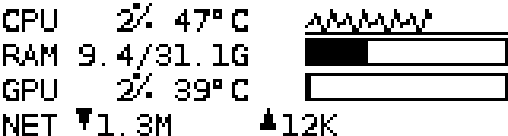
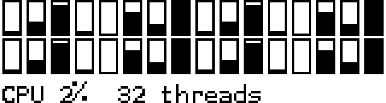
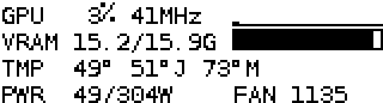
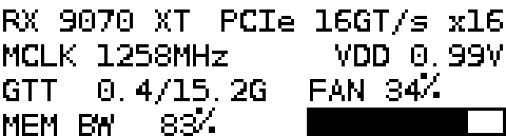
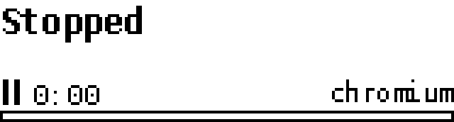
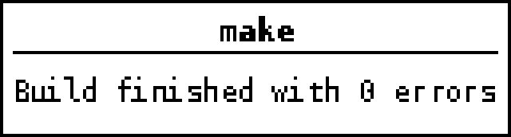
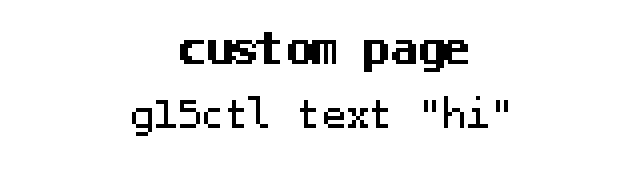

# g15lcd

User-level Python daemon that drives the 160x43 monochrome LCD of the Logitech G15 (gen 1, USB `046d:c222`) on Linux, plus `g15ctl`, a small CLI to control it. Pages: `clock`, `sysstats` (CPU/RAM/GPU/net), `gpu` (amdgpu load/VRAM/temps/power/fan), `media` (MPRIS now-playing), `custom` (text/images pushed from scripts), and notification overlays.

## Why hidraw

The kernel `hid-lg-g15` driver already handles the G-keys, M-keys and the keyboard/LCD backlights (`/sys/class/leds/g15::*`). It does **not** expose the LCD, and `g15lcd` talks to the LCD through `/dev/hidraw*`, so both coexist without detaching anything. G-keys emit `KEY_MACRO*` events that you can bind in your desktop environment; the daemon never touches them. Unprivileged access comes from a udev `uaccess` rule, so no root and no libusb.

## Hardware facts

- USB ID `046d:c222`, LCD 160x43, 1 bit per pixel.
- LCD frame = output report `0x03`, 992 bytes: `buf[0]=0x03`, 31 zero bytes, then 6 bands of 160 bytes. Byte `32 + (y // 8) * 160 + x`, bit `y % 8` (LSB = top row). 43 rows use 5.4 bands; the last band is partial.
- Buttons arrive in input report `0x02`: the four buttons under the LCD (MENU2..MENU5) are bit 7 of bytes 2..5; the round key (MENU1) is bit 7 of byte 8.
- Backlight: `/sys/class/leds/g15::lcd_backlight/brightness` (0-2).

## Install (fish)

Run from the repo root.

```fish
# 1. udev rule (device access + backlight writable by group video)
sudo cp packaging/70-g15lcd.rules /etc/udev/rules.d/
sudo udevadm control --reload
sudo udevadm trigger -s leds -s hidraw

# 2. wrappers on PATH (they run this checkout; pip install --user is blocked on Arch)
mkdir -p ~/.local/bin
ln -sf (realpath packaging/g15lcd) ~/.local/bin/g15lcd
ln -sf (realpath packaging/g15ctl) ~/.local/bin/g15ctl

# 3. user service (runs ~/.local/bin/g15lcd)
mkdir -p ~/.config/systemd/user
cp packaging/g15lcd.service ~/.config/systemd/user/
systemctl --user daemon-reload
systemctl --user enable --now g15lcd

# 4. config (optional; every key has a default)
mkdir -p ~/.config/g15lcd
cp packaging/config.example.toml ~/.config/g15lcd/config.toml

# 5. fish completion (completes page names from the running daemon)
mkdir -p ~/.config/fish/completions
cp packaging/g15ctl.fish ~/.config/fish/completions/
```

Dependencies (system packages): `python-pillow`, `python-psutil` (sysstats), `python-dbus` (media). The unit is ordered after `graphical-session.target` so the session bus used for MPRIS exists. Without psutil/dbus the corresponding page is skipped with a log message.

## Buttons

| Button | Action |
| --- | --- |
| Round key (MENU1) | Toggle LCD backlight (level from `[backlight] on_level`) |
| Under-LCD key 1 (MENU2) | Previous page |
| Under-LCD key 2 (MENU3) | Next page |
| Under-LCD key 3 (MENU4) | Page action 1 |
| Under-LCD key 4 (MENU5) | Page action 2 |

While a notification is on screen, MENU2-MENU5 instead dismiss it (the next queued one shows) and the press does nothing else. MENU1 still toggles the backlight. Page-name labels are not notifications and never swallow presses.

Page actions: `clock` none; `sysstats` MENU4/MENU5 = previous/next view (summary / per-core bars); `gpu` MENU4/MENU5 = previous/next view (summary / detail); `media` MENU4 = play/pause, MENU5 = next track; `custom` none.

## Control protocol

`g15ctl` is a thin client for a Unix socket (`$XDG_RUNTIME_DIR/g15lcd.sock`, override with `--socket`). One JSON object per line in, one JSON line out: `{"ok": true, ...}` or `{"ok": false, "error": "..."}`.

| cmd | Fields | Reply |
| --- | --- | --- |
| `ping` | | `pong` |
| `pages` | | `pages` (list), `current` |
| `page` | `name`: page name, `next` or `prev` | `page` |
| `notify` | `text`, optional `title`, `seconds` (0-300] | `queued` |
| `dismiss` | optional `all` (bool; also clear queued) | `dismissed` (count) |
| `text` | `text`, optional `align` (`left`/`center`), `show` | |
| `image` | `path` (absolute) or `data` (base64), optional `show` | |
| `backlight` | `level`: 0, 1, 2 or `"toggle"` | `level` |

`text` and `image` need `"custom"` in `pages`. Images are fitted to 160x43 and dithered to 1 bit.

## g15ctl examples

```fish
g15ctl pages
g15ctl page sysstats
g15ctl page next
g15ctl notify "Build finished" -t make -s 8
g15ctl text "Hello\nworld" --align center --show
echo "from stdin" | g15ctl text --show
g15ctl image ~/Pictures/logo.png --show
g15ctl backlight toggle

# scripting: tell the LCD when a long job ends
make; and g15ctl notify "build done"
make; g15ctl notify "make exit $status"
```

`\n` in text arguments becomes a newline. Exit status is non-zero if the daemon is unreachable or rejects the request.

## Desktop notifications

The daemon can mirror desktop pop-ups (anything sent to `org.freedesktop.Notifications`, e.g. by KDE Plasma, `notify-send`, chat apps) onto the LCD. It only observes: a monitor connection on the session bus (`BecomeMonitor`, falling back to an eavesdrop match) watches `Notify` calls in a separate thread, so the desktop's own pop-ups are unchanged. If the bus refuses, a warning is logged once and the bridge stays off; the daemon keeps running. Needs `python-dbus` and `python-gobject`.

**Privacy:** this copies notification text (message previews, senders) onto a physical screen that anyone near the keyboard can read. It is off by default; use `hide_body`, `include_apps` / `exclude_apps` and `min_urgency` to limit what is shown.

Enable it in the config:

```toml
[notify.desktop]
enabled = true
exclude_apps = ["Spotify"]
min_urgency = "normal"   # low | normal | critical
hide_body = false        # true: app + summary only
show_app = true          # app name on the title line, summary and text below
seconds = 5              # default [notify] default_seconds; critical shows 2x (max 300)
```

Markup in bodies (`<b>`, `<i>`, `<a href>`, ``; `<br>` becomes a line break) is stripped, entities are unescaped and whitespace collapsed. Notifications with an empty summary and body are skipped. A repeat with the same app and summary (or the same nonzero `replaces_id`) replaces the waiting or showing one in place and restarts its timer instead of queuing again. Mirrored notifications share the queue with `g15ctl notify` (max 20); press MENU2-MENU5 or run `g15ctl dismiss [--all]` to clear them. Test it with `notify-send -a demo "Hello" "from the desktop"`.

## Previews

Render a page to a 4x PNG with no device: `python -m g15lcd --render-page sysstats out.png` (run with `set -x PYTHONPATH $PWD`). Dark pixels are ON.

| Clock | Sysstats | Per-core view |
| --- | --- | --- |
|  |  |  |

| GPU | GPU detail |
| --- | --- |
|  |  |

| Media | Notification | Custom |
| --- | --- | --- |
|  |  |  |

(`previews/` is git-ignored scratch output; `docs/img/` holds the tracked copies.)

## Troubleshooting

- **No device found**: check `ls -l /dev/hidraw*` and `lsusb | grep 046d:c222`; the daemon retries and reattaches on replug.
- **Permission denied on /dev/hidraw**: the udev rule is missing or not applied. Re-run the udev commands above, then replug or `sudo udevadm trigger -s hidraw`. Check with `getfacl /dev/hidrawN` (your user should have an ACL).
- **Backlight not writable**: the sysfs file is root-owned unless the rule's `chgrp video`/`chmod g+w` ran. Make sure you are in the `video` group (`id`), then `sudo udevadm trigger -s leds`.
- **Media page says no player**: the service must run inside your graphical session (see the unit's `After=graphical-session.target`); check `systemctl --user status g15lcd`.
- **Logs**: `journalctl --user -u g15lcd -f`. For verbose output run `python -m g15lcd -v` manually (stop the service first).
- Config errors make the daemon exit with status 2; the message is in the journal.

## Layout and tests

`g15lcd/` (device, render, daemon, ipc, ctl, config, `pages/`), `packaging/` (udev rule, service, example config, fish completion, `g15lcd`/`g15ctl` wrappers), `tests/`. Run tests with `python -m unittest discover -v`.

## License

MIT, see [LICENSE](LICENSE).
